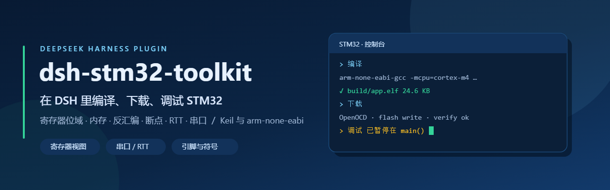
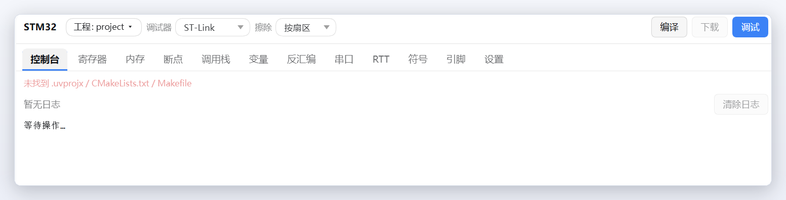

# dsh-stm32-toolkit

[简体中文](./README.md) | English

> **Build, flash, and debug STM32 projects in DSH, with an Agent alongside you.**

[](https://www.npmjs.com/package/@lylgj/dsh-stm32-toolkit)
[](./LICENSE)



An STM32 development plugin for DeepSeek Harness. Go from project discovery and builds to flashing and live debugging through a sidebar workbench, 19 Agent tools, or `/stm32` commands. All three share the same project and configuration.

[Install](#install) · [Quick start](#quick-start) · [Requirements](#requirements) · [Tools and commands](#tools-and-commands) · [Uninstall](#uninstall)

## Preview



## Features

- **Projects and builds:** Detect Keil `.uvprojx`, CMake, and Makefile projects; build with Keil or GCC. Without Keil, `.uvprojx` projects are automatically exported to CMake / GCC before building.
- **Firmware flashing:** Sector or full-chip erase, verification, and reset; OpenOCD for ST-Link / CMSIS-DAP and a native SEGGER backend for J-Link.
- **Live debugging:** Pause, continue, step, and reset; execution breakpoints, conditional breakpoints, and data watchpoints.
- **Device inspection:** Core and peripheral registers, SVD bit fields, memory, call stacks, local variables, expressions, and disassembly.
- **Serial and RTT:** Serial port discovery, text / HEX communication, and SEGGER RTT logs through OpenOCD.
- **Utilities:** Symbol lookup, static pin maps, CubeMX `.ioc` editing, basic CMake project creation, and GCC / OpenOCD installation.

## Install

### DSH Desktop

Open **Plugins → Add plugin**, enter the package below, and install it through the app's plugin manager:

```text
@lylgj/dsh-stm32-toolkit
```

Fully quit and reopen DSH, then select **STM32** in the sidebar.

### CLI: dsh web / custom profile

```sh
dsh plugin --profile web add @lylgj/dsh-stm32-toolkit
```

Replace `web` with your actual profile name if needed, then restart that DSH instance.

## Quick start

1. Open **STM32 → Settings**, select your project directory, and confirm the chip model.
2. Check the toolchain. **Download and install toolchain** installs GCC / OpenOCD. Prepare CMake, Ninja / Make, Keil and SEGGER J-Link software separately as required by your project.
3. Select the probe and flash / debug backend. Connect the board and check power, drivers, and SWD / JTAG wiring.
4. **Build** first. Confirm the generated firmware before **Flash**, then start debugging and inspect breakpoints, registers, and memory.

You can also ask the Agent:

```text
Check my STM32 development environment and list any missing tools.
Open D:\work\demo_project and build it. Do not flash yet.
After confirming the firmware, flash and verify it, then start debugging at main.
Show the GPIOA registers and the current call stack.
```

## Requirements

DSH **0.2.2-rc.1 or later** and Node.js **20 or later**. Install the tools needed for your workflow:

| Workflow | Required tools |
|---|---|
| Keil builds | Keil MDK / UV4, plus the project's compiler and device packs |
| CMake projects / exported Keil projects | arm-none-eabi-gcc, CMake, and Ninja or Make |
| Makefile projects | arm-none-eabi-gcc and Make |
| ST-Link / CMSIS-DAP flashing and debugging | OpenOCD and probe drivers; arm-none-eabi-gdb for debugging |
| Native J-Link flashing and debugging | SEGGER J-Link software; arm-none-eabi-gdb for debugging |
| RTT logs | OpenOCD and SEGGER RTT integrated into the firmware |

Desktop normally provides its own Node.js runtime; no separate installation is usually needed. Tool paths are usually detected automatically; you can also set them in the workbench's **Settings**.

## Tools and commands

| Group | Tools |
|---|---|
| Projects and configuration | `stm32_project`, `stm32_doctor`, `stm32_config`, `stm32_env` |
| Build and flash | `stm32_build`, `stm32_export`, `stm32_flash` |
| Debug control | `stm32_debug`, `stm32_breakpoint` |
| Device inspection | `stm32_registers`, `stm32_memory`, `stm32_stack`, `stm32_watch`, `stm32_disasm` |
| Utilities | `stm32_serial`, `stm32_rtt`, `stm32_symbols`, `stm32_pins`, `stm32_ioc` |

Manual commands include `/stm32 status`, `/stm32 build`, `/stm32 flash`, `/stm32 debug start`, and `/stm32 regs GPIOA`.

## Notes

- Keil export does not guarantee compatibility with every ARMCC-specific language feature, library or linker setting. Use the Keil backend when necessary.
- Editing an .ioc file does not run CubeMX to generate a complete HAL project; the built-in creator provides a basic project skeleton.
- Pin maps come from static analysis and may miss complex macros or indirect calls. Cross-check them against your schematic and project.

## Hardware safety

Flashing, erasing, writing memory, and running code change real hardware state. Confirm the target chip, firmware, addresses, and erase options before proceeding. Back up important data, and ensure attached equipment is safe to operate before starting or resuming execution.

## Uninstall

In DSH Desktop, find the plugin on the **Plugins** page, choose **Uninstall**, then fully quit and reopen DSH.

For CLI installations, remove it from the same profile used for installation:

```sh
dsh plugin --profile web remove @lylgj/dsh-stm32-toolkit
```

Replace `web` with your actual profile name, then restart that DSH instance.

## License

[MIT](./LICENSE). Keil, SEGGER software, GCC, OpenOCD, SVD files, and project dependencies retain their own licenses. The plugin's MIT license does not replace their terms. Third-party tools are installed locally or downloaded on demand, not bundled with the plugin.
