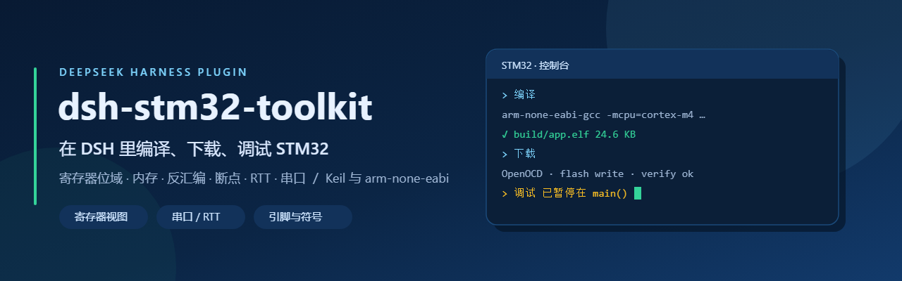
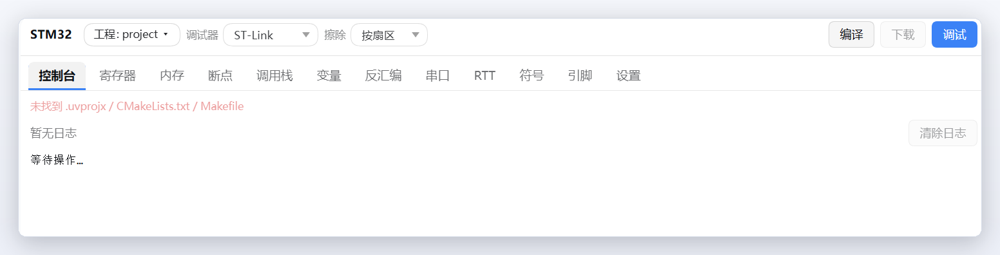

# dsh-stm32-toolkit

<p align="center"></p>

DeepSeek Harness 的 STM32 开发插件。参照 Keil MDK 的工作方式，把「工程识别 → 编译 → 下载 → 在线调试 → 断点 / 寄存器 / 内存 / 反汇编」搬进 DSH：

- **侧边栏 STM32 工作台**：编译、下载、启动/停止调试、暂停/继续、单步、复位，日志、内核寄存器、外设寄存器、内存、断点/监视点、调用栈、变量求值、反汇编、串口监视器、RTT 日志、符号表、引脚图、设置（工程与工具链配置直接内嵌在工作台里，不用再开设置窗口）。
- **19 个 Agent 工具**（`stm32_*`），可以让模型直接编译、下载、下断点、读寄存器、开关串口、看 RTT、查符号/引脚、装工具链、建工程。
- **`/stm32` 斜杠命令**，手工快速操作。
- **双后端**：装了 Keil 就用 `UV4.exe`（AC5/AC6 均可）；没有 Keil 就用 `arm-none-eabi-gcc/gdb + CMake/Make + OpenOCD`。没装 Keil 时打开 Keil 工程直接点“编译”即可：插件会把 `.uvprojx` 自动导出成 CMake（GNU 启动文件 + 生成的 `linker.ld`，FreeRTOS 的 RVDS 移植层自动换成 GCC 版本），再用 arm-none-eabi 编译。
- **一键装工具链**：设置页「下载并安装工具链」，从 xPack 官方 GitHub Release 拉 arm-none-eabi-gcc/gdb 与 OpenOCD，解压到 `%DSH_HOME%\stm32\tools\` 并自动写回配置。
- **寄存器查看**：解析 CMSIS-SVD（Keil Pack 里找，找不到自动从 cmsis-svd-data 下载并缓存），按位域解码，支持内核寄存器（R0–R15、xPSR、MSP/PSP、CONTROL、PRIMASK…）。
- **下载选项**：按扇区擦除 / 整片擦除、下载后校验、下载后复位。
- **串口监视器**：枚举 COM 口、打开/关闭、收发文本或 HEX（PowerShell 桥接，无需原生模块）。
- **RTT 日志**：OpenOCD `rtt setup/start/server` + TCP 流，按通道查看 SEGGER RTT 输出。
- **符号表 / 引脚图**：解析 Keil `.map`、GNU `.map`、`nm` 或 ELF 符号表；静态扫描 `HAL_GPIO_Init`、`#define` 引脚宏和 `{GPIOx, GPIO_PIN_n}` 静态表生成引脚占用图。
- **CubeMX `.ioc`**：读取/修改 `.ioc`，或一键生成 CMake 工程骨架（`.ioc` + `CMakeLists.txt` + 链接脚本 + startup + main.c）。
- **多核**：识别 H7 双核，调试时可切换 `core 0/1`（OpenOCD `-c core N`）。
- **路径选择器（Windows 资源管理器风格）**：设置里每个路径项（工程目录、SVD、UV4、OpenOCD、GCC、GDB、Ninja、符号表、.ioc）都有「浏览…」按钮；弹窗带面包屑地址栏、磁盘侧栏、名称筛选、选中高亮，单击选中、双击进入/打开，Enter 确认、Esc 关闭；工作台工具栏的工程名也能直接点开切换工程。

## 界面

<p></p>

STM32 工作台：顶部是工程、调试器、擦除方式和编译 / 下载 / 调试；下面是控制台、寄存器、内存、断点、调用栈、变量、反汇编、串口、RTT、符号、引脚、设置这些页签，编译日志和状态提示都输出在控制台里。

## 安装

需要 DeepSeek Harness `>= 0.2.1-rc.2`、Node `>= 20`。

**在界面里装（推荐）**

左侧栏 →「插件」→「添加插件」，在「包名或地址」里填：

```
@lylgj/dsh-stm32-toolkit
```

点「安装」。

**用命令行装**

```powershell
dsh plugin --profile desktop add @lylgj/dsh-stm32-toolkit
```

npm 源不通时可以换成 `github:Lylgj/dsh-stm32-toolkit`（内容相同，但插件页不会显示版本更新）。

**从源码装（自己改代码时）**

```powershell
dsh plugin --profile desktop add "D:\你的路径\dsh-stm32-toolkit"
```

本地目录必须写绝对路径。这样装进去的是目录副本，改完源码要重新安装一次（或把 `src/`、`client.js`、
`package.json`、`cordis.patch.yml` 复制到 profile 的 `node_modules\@lylgj\dsh-stm32-toolkit\`）再重启。

装完 **重启 DeepSeek Harness 桌面应用**（desktop profile 由 Electron 独占，运行中无法热加载 host 插件）。重启后：

- 左侧栏出现 **STM32** 图标 → 打开工作台；
- 工作台里的「设置」标签页可配置工程与工具链（不再单独占用“设置”窗口）；
- 对话里可用 `stm32_*` 工具和 `/stm32` 命令。

## 首次配置

打开**侧边栏 STM32 工作台 → 设置标签页**，也可以让 Agent 调用 `stm32_config`，或用 `/stm32`：

| 配置项 | 说明 |
| --- | --- |
| `projectDir` | 工程目录，例如 `D:\work\demo_project`；留空则用当前工作目录 |
| `device` | 芯片型号，例如 `STM32F407VGTx`（从 .uvprojx 自动读取） |
| `svdPath` | SVD 文件；留空自动在 Keil Pack / 缓存 / 网络查找 |
| `backend` | `auto` / `keil` / `gcc` |
| `uv4Path` / `openocdPath` / `gdbPath` / `gccPath` | 手动指定可执行文件（一般留空自动探测） |
| `ninjaPath` / `cmakePath` | 手动指定 Ninja / CMake（一般留空自动探测） |
| `probe` | `stlink` / `cmsis-dap` / `jlink` |
| `interfaceCfg` / `targetCfg` | OpenOCD 配置；留空按芯片和调试器自动推荐 |
| `adapterSpeed` / `gdbPort` | SWD 速度（kHz）/ GDB Server 端口 |
| `flashErase` / `flashVerify` / `flashReset` | 下载时整片擦除 / 校验 / 复位 |
| `serialPort` / `serialBaud` | 串口监视器默认端口 / 波特率 |
| `rttPort` / `rttChannel` | RTT 的 OpenOCD TCP 端口 / 通道号 |
| `rttSearchStart` / `rttSearchSize` | 找不到 `_SEGGER_RTT` 时 RTT 控制块的搜索范围 |
| `symbolFile` | 指定 `.map` / `.elf` / `.axf`；留空自动找 |
| `iocFile` | 指定 CubeMX `.ioc`；留空自动找 |
| `core` | 多核芯片的调试核（0 / 1） |

配置保存在 `%DSH_HOME%\stm32\config.json`（默认 `%USERPROFILE%\.dsh\stm32\config.json`），SVD 缓存在同目录 `svd\`，构建日志在 `logs\`。

## Agent 工具

| 工具 | 作用 |
| --- | --- |
| `stm32_project` | 识别/切换工程，返回芯片、目标、产物、SVD、推荐 OpenOCD 配置 |
| `stm32_doctor` | 检查 Keil / GCC / OpenOCD / CubeProgrammer / 已连接调试器 |
| `stm32_config` | 读写配置 |
| `stm32_build` | 编译（Keil `UV4 -b`；没装 Keil 时自动把 .uvprojx 导出为 CMake 用 GCC 编译；CMake/Makefile 直接构建），返回错误、警告、固件路径 |
| `stm32_export` | 把 Keil `.uvprojx` 导出为 CMake/GCC 工程（源文件、include、宏、GNU 启动文件、linker.ld） |
| `stm32_flash` | 下载（OpenOCD `program verify reset`；无 OpenOCD 时 Keil `UV4 -f`）；可整片擦除、关闭校验/复位 |
| `stm32_debug` | 调试会话 start/stop/continue/pause/step*/reset/status |
| `stm32_breakpoint` | 断点/监视点 add/remove/list（函数、`file:line`、地址；条件断点、硬件断点、读/写监视点） |
| `stm32_registers` | `core` / `peripheral GPIOA` / `list` / `register GPIOA.MODER` |
| `stm32_memory` | 读/写内存（hex） |
| `stm32_stack` | 调用栈 + 局部变量 |
| `stm32_watch` | 求值 C 表达式 / 查看变量 |
| `stm32_disasm` | 反汇编 |
| `stm32_serial` | 串口：ports / open / close / write / read / clear |
| `stm32_env` | 工具链一键安装/状态：status / install（gcc、openocd 或 all） |
| `stm32_symbols` | 符号表：find 按名字查、at 按地址找最近符号、info 概览 |
| `stm32_pins` | 静态引脚图（扫描 HAL_GPIO_Init 与 Write/Toggle 调用，可按端口过滤） |
| `stm32_ioc` | CubeMX `.ioc`：inspect / set（改键值）/ create（生成 CMake 工程骨架） |
| `stm32_rtt` | RTT：start / stop / state / write / clear |

示例：

```text
用 stm32_project 打开 D:\work\demo_project
用 stm32_build 编译
用 stm32_flash 下载
用 stm32_debug 启动调试并运行到 main
在 main 下断点，然后 continue；停下来后读 GPIOA 寄存器
```

斜杠命令：

```text
/stm32 status
/stm32 build [clean]
/stm32 flash
/stm32 debug start|stop|continue|pause|step|reset
/stm32 regs [GPIOA]
/stm32 mem 0x20000000 64
```

## 工作台

- **工具栏**：编译 / 下载 / 启动调试 / 暂停·继续 / 单步 / 复位。
- **Console**：构建、下载、GDB 输出和错误。
- **Registers**：内核寄存器 + SVD 外设寄存器（选择外设，按位域显示值、含义、复位值）。
- **Memory**：输入地址读 hexdump。
- **Breakpoints**：执行断点（位置、条件、硬件）与监视点（读 / 写 / 读写）。
- **Stack**：调用栈帧 + 局部变量。
- **变量**：添加 C 表达式，停下来时逐个求值。
- **反汇编**：从当前 PC 或指定地址反汇编，高亮 PC。
- **串口**：选择 COM 口和波特率，文本/HEX 收发。
- **RTT**：开启后实时显示 SEGGER RTT 通道输出，可直接发送文本。
- **符号**：按名字搜索符号、按地址找最近符号，显示源码位置。
- **引脚**：静态扫描工程源码生成的引脚占用表（支持 `#define` 引脚宏与静态引脚表），可按端口过滤。
- **设置**：工程目录、芯片、工具链路径、调试器、擦除/校验/复位、串口、RTT、符号与多核参数全部内嵌在工作台「设置」标签页里（左侧分区导航，点一下跳到对应卡片），保存后立即生效；DSH 自己的“设置”窗口里不再单独出现 STM32 页。
- 状态栏显示芯片、目标、后端、调试状态、当前停止位置、固件文件和环境检测结果。

## 工作原理

```
src/index.js        host 入口：注册工具 / 命令 / /api/stm32 路由，持有 Stm32Service
src/service.js      配置、工程缓存、工具链探测、build/flash/debug 调度
src/tools.js        Agent 工具定义（JSON Schema + 渲染）
src/commands.js     /stm32 命令
src/engine/uvprojx.js   Keil .uvprojx 解析（芯片、宏、include、产物、调试器）
src/engine/project.js   工程发现、产物查找、SVD 定位/缓存/下载
src/engine/build.js     Keil UV4 / CMake / Make 构建与日志解析
src/engine/gdb.js       GDB/MI2 会话（断点、内存、栈、反汇编、变量）
src/engine/debug.js     OpenOCD + GDB 调试会话生命周期
src/engine/openocd.js   OpenOCD GDB Server 启动、固件下载、就绪探测
src/engine/svd.js       CMSIS-SVD 解析（derivedFrom、dim、cluster、位域枚举）
src/engine/registers.js 内核寄存器 / 外设批量读取与解码
src/engine/mi.js        GDB/MI 解析器
src/engine/serial.js    串口枚举与 PowerShell 串口桥
src/engine/install.js   xPack arm-none-eabi-gcc / OpenOCD 一键安装
src/engine/symbols.js   Keil/GNU map、nm、ELF 符号表解析
src/engine/ioc.js       CubeMX .ioc 解析/修改与 CMake 工程骨架生成
src/engine/pins.js      源码静态扫描生成引脚图
src/engine/rtt.js       OpenOCD RTT + TCP 流
client.js           Web 工作台与内嵌设置页（React，无构建步骤）
```

插件 host 侧只依赖 Node 内置模块；client 侧只 `require('react')`。

## 验证状态（2026-11-11）

- `npm test`：**39 个测试全部通过**（SVD/MI/uvprojx 解析、构建日志、OpenOCD 下载命令、HTTP 路由、工具执行、斜杠命令、串口桥、`.ioc`、map/ELF 符号、引脚扫描（含 `#define` 宏与静态表）、工具链安装参数、Keil→CMake 导出、设置页与路径选择器渲染冒烟）。
- 真实 Keil 工程 `D:\work\demo_project\MDK-ARM\Project.uvprojx` 解析通过：STM32F407VGTx / STM324xG_EVAL / 152 个源文件 / IROM 0x08000000 1MB / IRAM 0x20000000 128KB。
- 同一工程导出 CMake 通过：150 个可编译源文件、18 个 include、3 个宏；Keil 汇编启动文件被 GNU 启动文件替换，FreeRTOS 的 RVDS 移植层自动换成 GCC 版本。
- 真实 SVD 下载并解析通过：`STM32F407.svd` 91 个外设，GPIOA 0x40020000，MODER 16 个位域。
- **真实 GCC 编译通过**：手动安装 xPack arm-none-eabi-gcc 15.2.1 + ninja 1.13.2 后，`createIoc` 生成的 `demo_project` 编译成功（text 588 B）；真实 Keil 工程 `D:\work\demo_project` 自动导出 CMake 后编译成功，产物 `.elf/.hex/.bin`，`text 212620 data 580 bss 117608`，链接错误 0。导出时自动补齐 CMSIS 头目录、替换 RVDS→GCC 移植层、放宽 AC5 风格告警（`-Wno-int-conversion` 等）。
- 在独立 smoke profile 中真实启动 DSH Web 实例验证：状态快照含 `rtt/install/cores`；`GET /api/stm32/{env,symbols,pins,ioc,rtt}` 正常；真实 HAL 工程扫描出 22 个引脚；`POST projectCreate` 生成 6 个文件的 CMake 工程；`POST envInstall` 能下载并安装 xPack 工具链。
- 未接探针时 `debugStart`/`flash` 会明确提示“没有找到调试器 / 找不到固件”，不会假装成功。

**未验证**（本机没有相应环境，插件会在界面上如实报错，不会假装成功）：

- Keil UV4 实际编译：本机未安装 Keil（已用 GCC 后端完成真实编译，见上）；
- OpenOCD 实际下载、GDB 调试：没有连接 ST-Link/CMSIS-DAP；
- 实际硬件断点 / 寄存器读值、RTT 真实输出。

装好工具链并接上探针后，用 `stm32_doctor` 确认环境，再依次 `stm32_build → stm32_flash → stm32_debug` 即可。

## 一键安装工具链

工作台 → 设置 → 工具链卡片里的 **下载并安装工具链**，或 Agent 工具 `stm32_env`（`action:'install'`，可选 `gcc` / `openocd` / `all`）：

- 优先走 GitHub API 取最新 Release；API 不可用时从 `releases/latest` 发布页解析；再不行用内置地址；
- GitHub 直连失败会自动再试 `https://ghproxy.net/` 镜像；
- 下载有 90 秒无数据看门狗，避免网络卡住时无限挂起；
- 解压到 `%DSH_HOME%\stm32\tools\<component>`，自动写回 `gccPath` / `gdbPath` / `openocdPath` / `openocdScripts`；
- 当前内置版本：xPack arm-none-eabi-gcc `15.2.1-1.1`、OpenOCD `0.12.0-7`。

网络不好时也可以手动装：下载 `xpack-arm-none-eabi-gcc-15.2.1-1.1-win32-x64.zip` 解压到 `%DSH_HOME%\stm32\tools\gcc\`，再把 `gccPath` 指向 `bin\arm-none-eabi-gcc.exe`；CMake 构建还需要 Ninja 或 make（Windows 上推荐 `ninja.exe`，填 `ninjaPath`），否则会报 `CMake was unable to find a build program`。

## 路线图

- CubeMX 图形化代码生成（当前只做 `.ioc` 读写与静态 CMake 骨架，后续可接 headless CubeMX）；
- 芯片固件包（Keil DFP / CMSIS 包）一键安装；
- 基于 ELF 的源码级反汇编与源码视图；
- 双核核间调试的更多细节（核间流水线、共享内存视图）。

## 已知限制

- AC5 专用工程（例如依赖 ARMCC 内建/分散加载）不能直接用 GCC 构建；这类工程请保留 Keil 后端。
- 调试需要 `arm-none-eabi-gdb`（或 `gdb-multiarch`）与 OpenOCD；插件会自动找 PATH、`%ProgramFiles%`、`%LOCALAPPDATA%\Programs`，也可以在工作台设置里一键安装。
- RTT 需要目标固件里链接了 SEGGER RTT 组件（`_SEGGER_RTT` 符号）；纯裸机工程需要先加 RTT 源码。
- 引脚图是静态扫描结果，宏拼接/间接调用可能识别不到；以 CubeMX `.ioc` 和实际编译结果为准。
- 面板轮询 1s 刷新状态；构建/下载是后台任务，结束后刷新。

## 许可说明

本插件自身以 **MIT** 发布。插件**不打包、不分发**任何第三方二进制；工具链是运行时由你（或在 工作台 → 设置 里点击「下载并安装工具链」）从上游官方发布页下载到本机 `%DSH_HOME%\stm32\tools\` 的。

| 组件 | 许可 | 商用 | 说明 |
| --- | --- | --- | --- |
| Keil MDK（`UV4.exe`） | 商业闭源 | 需购买 License | 插件**从不**下载或内置 Keil，只调用你本机已安装的 UV4；Lite 版免费但限制 32KB 代码，Arm 另有非商用社区授权 |
| arm-none-eabi-gcc / binutils | GPLv3（含 GCC Runtime Library Exception） | 免费 | 编译产物不受 GPL 传染，固件可闭源商用 |
| newlib（C 库） | BSD 类宽松许可 | 免费 | 链接进固件无附加义务 |
| arm-none-eabi-gdb | GPLv3 | 免费 | 调试器 |
| OpenOCD | GPLv2 | 免费 | 下载 / 调试 / RTT 服务 |
| CMake | BSD-3-Clause | 免费 | 插件只检测调用，不随附 |
| xPack 打包 | MIT（仅打包脚本/元数据） | 免费 | 包内二进制沿用上游 GPL 许可 |
| SVD 描述文件（`cmsis-svd-data`） | 各芯片厂商原文许可（多为 BSD-3 / Apache-2.0） | 免费 | 只读解析，用于寄存器解码 |

要点：

- **开源 ≠ 无版权**：GPL/BSD 都是版权许可，只是授予了免费使用、修改、再分发的权利。
- 自己用、公司内部用这些工具链都没有授权费用；**只有 Keil MDK 是付费软件**，装不装、买不买由你决定，与插件无关。
- 如果你要把下载下来的 OpenOCD / GCC 二进制**再打包分发**给别人，需要履行 GPL 的源码与许可声明义务；插件本身是在本机现下现用，不做二次分发。
- 工程里的 STM32 HAL 库（BSD-3）、CMSIS（Apache-2.0）同样可免费商用。

## License

MIT

