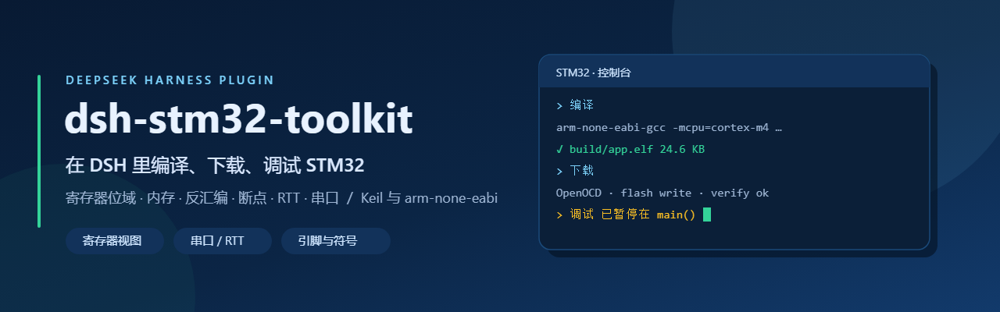
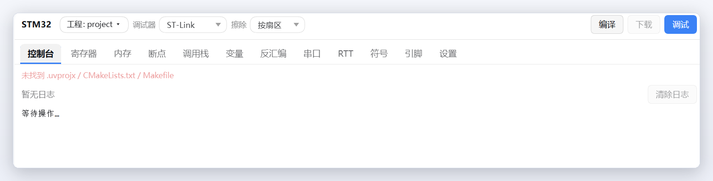

<div align="center">



# 🧩 dsh-stm32-toolkit

**在 DeepSeek Harness 里编译、下载、调试 STM32，也让 Agent 一起上手。**

一个 DeepSeek Harness 插件：侧边栏工作台、19 个 Agent 工具和 `/stm32` 命令，共用同一份工程、同一份配置和同一个调试会话。
工程可以是 Keil `.uvprojx`、CMake 或 Makefile；编译走 Keil UV4 或 arm-none-eabi-gcc，
固件经 OpenOCD 或 SEGGER J-Link 写入芯片，调试由 GDB 接管。

[](https://www.npmjs.com/package/@lylgj/dsh-stm32-toolkit)
[](https://www.npmjs.com/package/@lylgj/dsh-stm32-toolkit)
[](./LICENSE)
[](https://nodejs.org)
[](https://github.com/deepseek-ai/deepseek-harness)

[简体中文](README.md) · [English](README.en.md)

```sh
dsh plugin --profile web add @lylgj/dsh-stm32-toolkit
```

</div>

> 主仓库：<https://github.com/Lylgj/dsh-stm32-toolkit>　·　npm 页：<https://www.npmjs.com/package/@lylgj/dsh-stm32-toolkit>　·　许可证：[MIT](./LICENSE)

## 界面



面板在侧边栏「STM32」里：顶部是工程选择、调试器、擦除方式与「编译 / 下载 / 调试」，下面是控制台、源码、内存、反汇编、串口、RTT、符号、引脚和设置页签。
启动调试后会另开一个窗口，集中显示源码、局部变量、调用栈、寄存器和变量。

## 安装

### ① 桌面版

1. 打开 DSH 桌面版，进入「插件」页。
2. 点「添加插件」，填包名 `@lylgj/dsh-stm32-toolkit`，或填本地目录的绝对路径。
3. 等安装结束，**完全退出** DSH（包括托盘图标）再重新打开；侧边栏出现「STM32」即安装成功。

### ② 命令行

```sh
dsh plugin --profile web add @lylgj/dsh-stm32-toolkit       # 装进 web profile
dsh plugin --profile desktop add @lylgj/dsh-stm32-toolkit   # 桌面版用 desktop profile
```

`--profile` 必须和实际运行的实例一致，装错 profile 时面板不会出现。装完同样要完全重启。

### ③ 从源码

```sh
git clone https://github.com/Lylgj/dsh-stm32-toolkit.git
cd dsh-stm32-toolkit
dsh plugin --profile web add <本目录的绝对路径>
```

本地路径请写成绝对路径。改过 `src/` 或 `client.js` 之后，重新执行一次 `add` 让 DSH 重新加载插件。

### ④ 升级与卸载

```sh
dsh plugin --profile web add @lylgj/dsh-stm32-toolkit@latest   # 升级
dsh plugin --profile web remove @lylgj/dsh-stm32-toolkit        # 卸载
```

桌面版直接在「插件」页升级或卸载。卸载插件不会删除 `<DSH_HOME>/stm32/` 下的配置文件和已下载的工具链，需要清理时手动删掉该目录。

### ⑤ 必须完全重启

安装、升级、卸载之后都要**完全重启** DSH：面板、19 个工具和 `/stm32` 命令在进程启动时注册，只关窗口或刷新页面不够。桌面版请从托盘菜单退出进程后再启动。

## 第一次运行

1. 点侧边栏「STM32」打开工作台。
2. 点顶部的工程按钮，选择工程目录（含 `.uvprojx`、`CMakeLists.txt` 或 `Makefile`），确认识别出的芯片型号。
3. 打开「设置」页看工具链状态；缺 GCC / OpenOCD 就点「下载并安装工具链」，或让 Agent 调 `stm32_env`。
4. 在工具栏选调试器（ST-Link / CMSIS-DAP / J-Link）和擦除方式（按扇区 / 整片擦除），后端保持 `auto`。
5. 点「编译」；第一次编译会按工程类型选 UV4、CMake 或 make，日志在控制台里。
6. 点「下载」写入芯片，然后点「调试」启动会话，程序停在 `main`，之后可以单步、看寄存器、加断点。

也可以直接对 Agent 说：

- 检查我的 STM32 环境，列出缺的工具。
- 打开 `D:\work\demo` 并编译，先不要下载。
- 编译通过后把固件下载到芯片并校验。
- 启动调试，在 `main` 停下来，然后读 GPIOA 的寄存器。
- 看一下当前调用栈和局部变量，再继续跑到下一个断点。

## 环境要求

### 一键安装能装什么

设置页的「下载并安装工具链」（Agent 侧是 `stm32_env` 的 `install`）会从 xPack 的 GitHub Releases 取两个 **Windows x64** 包：

| 组件 | 版本 | 主要内容 |
|---|---|---|
| arm-none-eabi-gcc | 15.2.1-1.1 | `arm-none-eabi-gcc`、`arm-none-eabi-gdb` |
| OpenOCD | 0.12.0-7 | `openocd` |

解压到 `<DSH_HOME>/stm32/tools/` 并自动写入配置，下载量合计约 300 MB。其他平台需要自行安装工具链，再在设置或 `stm32_config` 里填路径。工具链是否就绪按 `uv4 || (gcc && gdb && (openocd || jlink))` 判定。

### 需要自己准备

- **CMake 加 Ninja 或 Make**：编译 CMake 工程、或用 GCC 编译导出的 Keil 工程；找不到 Ninja 时 Windows 上回退到 MinGW Makefiles。
- **Keil MDK**：需要 UV4 作为编译后端或下载后端时装，并让插件能定位到 UV4。
- **SEGGER J-Link 软件**：使用 J-Link 后端下载或调试时装（`JLink.exe`、`JLinkGDBServerCL`）；探针驱动按厂商说明安装。
- **SVD 文件**：寄存器视图需要；工程能匹配到芯片时自动查找，必要时从 cmsis-svd 下载。

### 工程类型与所需工具

| 工程类型 | 编译 | 下载 / 调试 |
|---|---|---|
| Keil `.uvprojx` | UV4；或用 `stm32_export` 导出后走 GCC | UV4、OpenOCD、J-Link |
| CMake（`CMakeLists.txt`） | CMake + Ninja/Make + GCC | OpenOCD、J-Link |
| Makefile | make + GCC | OpenOCD、J-Link |
| 只有现成固件 | 不需要 | OpenOCD、J-Link、UV4 |

## Agent 工具

**工程与环境**

| 工具 | 说明 |
|---|---|
| `stm32_project` | 查看或切换当前工程，返回芯片型号、构建产物与 SVD |
| `stm32_doctor` | 检查 UV4、GCC/GDB、OpenOCD、J-Link、CubeProgrammer 与已连接探针 |
| `stm32_config` | 读取或修改配置，写入 `<DSH_HOME>/stm32/config.json` |
| `stm32_env` | 查看工具链状态，或下载安装 GCC / OpenOCD |

**编译与下载**

| 工具 | 说明 |
|---|---|
| `stm32_build` | 编译当前工程；Keil 走 UV4 `-b`，其他走 CMake / make |
| `stm32_export` | 把 Keil 工程导出为 CMake + GCC 工程，默认输出到 `<工程>/.dsh-gcc` |
| `stm32_flash` | 下载固件，可整片擦除、校验、下载后复位 |

**调试**

| 工具 | 说明 |
|---|---|
| `stm32_debug` | 启动 / 停止会话，继续、暂停、单步、复位、查状态 |
| `stm32_breakpoint` | 执行断点与读 / 写 / 读写监视点，支持条件与硬件断点 |
| `stm32_registers` | 读内核寄存器，或按 SVD 解码外设寄存器 |
| `stm32_memory` | 读 / 写目标内存（十六进制字节串） |
| `stm32_stack` | 读调用栈与当前帧局部变量 |
| `stm32_watch` | 求值 C 表达式或变量 |
| `stm32_disasm` | 反汇编目标代码 |

**周边辅助**

| 工具 | 说明 |
|---|---|
| `stm32_serial` | 串口监视与收发，不需要调试会话 |
| `stm32_rtt` | 通过 OpenOCD 读写 SEGGER RTT 日志 |
| `stm32_symbols` | 按名字或地址查符号，来源是 `.map` 或 ELF |
| `stm32_pins` | 引脚用途图，来自源码扫描与 `.ioc` |
| `stm32_ioc` | 读取 / 修改 `.ioc`，或生成最小 CMake 工程骨架 |

关键默认值：`backend auto`、`probe stlink`、`adapterSpeed 4000`、`gdbPort 3333`、`telnetPort 4444`、`flashErase none`、`flashVerify` 与 `flashReset` 为 `true`、`serialBaud 115200`、`rttPort 9090`、`runToMain` 为 `true`，持久化在 `<DSH_HOME>/stm32/config.json`。

## 命令

| 子命令 | 作用 |
|---|---|
| `/stm32 help` | 列出全部子命令 |
| `/stm32 status` | 工程、后端与调试会话状态 |
| `/stm32 project [目录]` | 查看或切换当前工程 |
| `/stm32 build [clean]` | 编译；带 `clean` 先清理 |
| `/stm32 flash` | 下载当前固件 |
| `/stm32 debug start\|stop\|status\|<动作>` | 启动 / 停止 / 查状态，或直接下发继续、暂停、单步 |
| `/stm32 regs [外设名]` | 读寄存器 |
| `/stm32 mem <地址> [字节数]` | 读内存 |
| `/stm32 stop` | 停止调试会话 |

## 使用提示

- 动手前先跑 `stm32_doctor` 或 `/stm32 status`；后端 `auto` 会按探针与已装工具选择 OpenOCD 或 J-Link。
- `.bin` 下载需要地址，优先级是调用参数、`binAddress`、按分散加载或内存图推断的结果；`.hex` / `.elf` 一般不用管。
- 在线调试需要 GDB 加 OpenOCD 或 J-Link GDB Server；只有 UV4 时能下载，但不能在线调试。
- `stm32_export` 只生成供 GCC 使用的工程，不改动原 Keil 工程；构建与下载默认超时 1200000 ms。

## 已知限制

- Keil 到 CMake 的导出只覆盖常见用法，即本来就能用 GCC 编译的 C/C++/汇编源码。只有 ARMCC 才能编译的源码（例如 FreeRTOS 的 RVDS 移植层）在包内提供 GCC 版本时会被替换，否则被跳过并在结果里列出。
- 引脚图是静态扫描：解析 `HAL_GPIO_Init` 与 `HAL_GPIO_WritePin`，展开 `#define`，再合并 `.ioc` 里的信号；复杂宏、间接调用和运行时才确定的方向可能识别不到。
- RTT 通过 OpenOCD 的 telnet 通道工作，只用 J-Link 后端时不可用。
- `stm32_ioc` 的 `set` 只改文件；`create` 生成最小 CMake 骨架，不会生成完整的 CubeMX 工程。
- 一键安装与探针检测按 Windows x64 实现，其他平台需要手动提供工具链；工作台状态约每秒轮询一次，构建和下载在后台执行。

## 安全

- 下载、擦除、写内存、复位都会立刻改变芯片状态，操作前确认工程、固件和探针对应的是同一块板子；整片擦除会清空程序与数据区。
- 下载 `.bin` 前核对地址；IAP 工程的自动推断只是参考，写错地址会覆盖引导程序。
- 调试会暂停 CPU，注意看门狗以及电机、加热、电源等外设在暂停期间的状态。
- 一键安装会从 GitHub 下载并解压可执行文件，请确认网络环境可信。

## 版本与兼容性

- 插件版本 0.1.1；Node.js ≥ 20；DeepSeek Harness ≥ 0.2.2-rc.1。
- 兼容性标记：`0.2.2-alpha.3` 不兼容，`0.2.2-rc.1` 兼容，`0.2.2-rc.2` 未验证。
- 可选的 peer 依赖 `@deepseek-ai/dsh-tools` ≥ 0.1.0-rc.7；客户端面板按 Web 平台打包，在 DSH 的网页界面里显示。

## 许可

MIT
